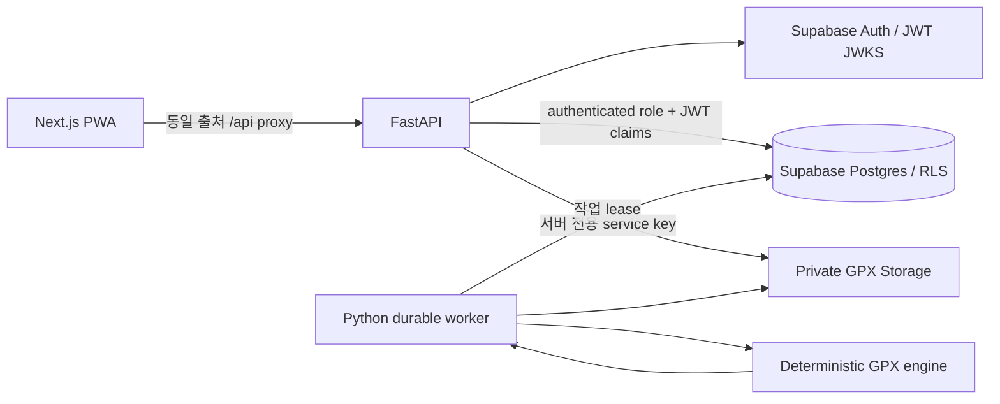

# 아키텍처

`apps/web`, `apps/api`, `supabase`, `samples`, `docs` 모노레포. 브라우저는 HTTP-only 세션 쿠키를 사용하고 Next rewrites를 통해 API에 접근한다. unsafe 쿠키 요청은 Origin 검사. API는 JWT 서명/issuer/audience/expiry를 검사한다. 개발 인증은 SQLite와 PBKDF2, 로컬 파일 저장을 사용하며 운영 모드에서는 금지한다.

운영 API는 사용자 요청마다 Postgres transaction에 `SET LOCAL ROLE authenticated`와 `request.jwt.claims`를 적용한다. 같은 요청에서도 소유권/크루 역할을 명시적으로 검사한다. 분석 worker는 별도 service role로 큐만 처리하며 HTTP 인터페이스가 없다. Supabase service key는 서버 Storage 및 계정 삭제에만 사용하고 클라이언트에 전달하지 않는다.

## 데이터 모델

profiles(id = Auth user UUID, display_name, goal_distance_km, goal_time_min, runs_per_week), crews(id, name, owner_id), memberships(crew_id, user_id 복합 PK, role, status, share_summary), invites(id, crew_id, code_hash, expires_at), runs(id, user_id, file_key, sha256, status, error, analysis JSONB, attempts, lease_until), plans(id, user_id, week_start, prescription JSONB), completions(plan_id, day_index 복합 PK, user_id, run_id nullable). 로컬 전용 users 테이블은 운영 migration에 존재하지 않는다.

요약 공유는 원본 runs SELECT를 열지 않고 security-definer `crew_summary` RPC에서 허용된 필드만 반환한다. 동의한 활성 회원의 완료 기록만 집계하며 최소 3명의 동의한 회원이 있어야 집계 표시(작은 표본의 개인 추정 제한). GPS 좌표는 분석 결과에 저장하지 않고 원본 파일에만 유지한다. 실행된 분석 버전과 경고를 결과에 포함한다.

## 파이프라인과 내결함성

업로드를 제한된 크기로 읽고 안전 XML parser로 검증한 후 Storage 저장 및 DB queued 생성. DB 생성 실패 시 파일 보상 삭제. DB UNIQUE(user_id, sha256)로 중복 제한. worker는 PostgreSQL SKIP LOCKED 또는 SQLite atomic update로 lease를 획득하며 120초 lease 만료 후 복구, 최대 3회 시도. 일반 분석 오류는 failed로 종료, 일시 I/O 오류만 재시도. 파일 삭제와 worker 완료 쓰기는 조건부 처리하여 삭제된 기록을 부활시키지 않는다. 외부 저장소/DB/Auth 분산 삭제는 외부 삭제 먼저, 실패 시 재시도 가능하게 기록을 유지한다. 계정 삭제 시 크루 소유권 양도 필요.

## 계산 정책

Haversine 지표, 분리된 trkseg 간 연결 금지, 최대 100,000점, 12 m/s 초과 GPS 연결 제외. dt <= 0 구간은 거리만 유효하고 시간 계산 제외 및 경고. 0.5 m/s 이상 연결을 이동 구간으로 간주. 고도 상승/하강은 연속 측정 3m deadband로 작은 jitter를 완화한다(기압계 보정 아님). HR 30–240 bpm 범위 밖 제외, 시간 가중 평균 및 유효 coverage 표시. split은 연결 내 선형 보간하여 1km 경계를 계산, 부분 마지막 split 명시. 시간 불완전 시 페이스를 표시하지 않아 정밀도 오인을 방지한다. 거리/고도는 GPS 측정치이며 공인 기록이 아니다.

코칭은 의료 목적이 아닌 보수적인 일반 훈련 가이드. 최근 28일 주간 평균과 최근 7일 중 작은 쪽을 기준으로 volume 5% 증가 이내, 신규는 주 3회 각 15분 run/walk. 목표 페이스는 목표 정보로 표시하되 검증되지 않은 고강도 처방에 쓰지 않는다. 최근 훈련 공백이면 복귀량 감소. 운동 강도는 말하기 테스트, 질적 운동은 일정한 최근 이력이 있을 때만 한 번. 통증/이상 증상은 훈련 중단 및 전문가 상담 안내.
