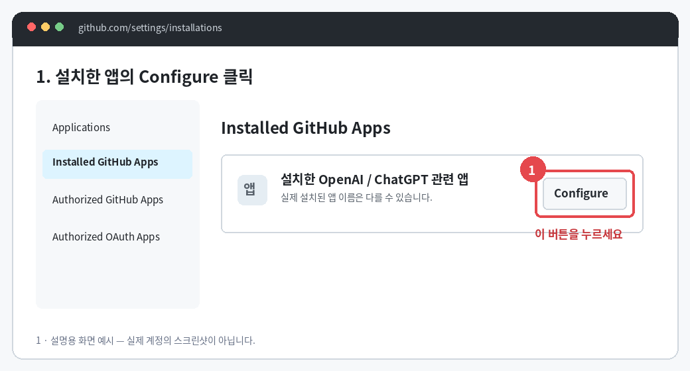
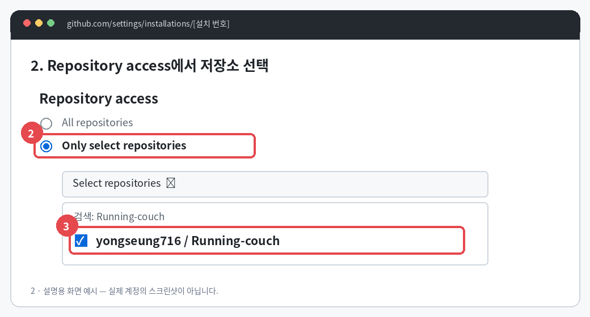
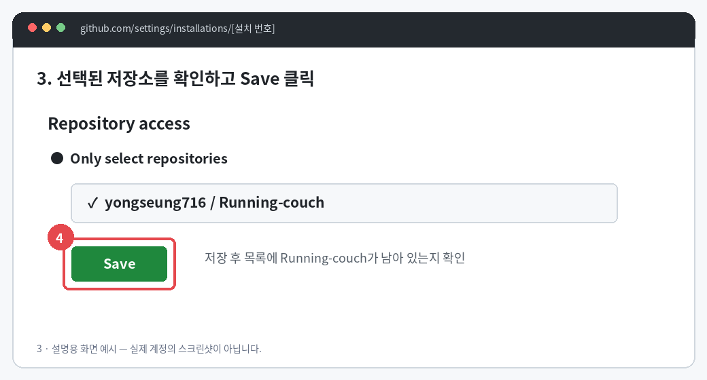

# GitHub 저장소 접근 설정 안내

이미지는 설명용 화면 예시이며 실제 계정의 스크린샷이 아닙니다.

정정: 일반 ChatGPT GitHub 연결은 공식적으로 읽기 전용입니다. Repository access에 저장소를 추가하는 것만으로 코드 쓰기 권한이 생기지 않습니다. 코드 생성·수정·push는 Codex의 저장소/환경 연결이 필요합니다. 현재 연결의 contents 쓰기 요청은 403으로 거절되었습니다.

1. https://github.com/settings/installations → Installed GitHub Apps → 설치한 OpenAI/ChatGPT 관련 앱 오른쪽 Configure.

2. Repository access → Only select repositories → Select repositories → Running-couch 검색 → yongseung716/Running-couch 선택. 기존에 All repositories라면 새 저장소를 별도 추가할 필요가 없습니다.

3. 선택 목록에서 Running-couch 확인 → Save → 저장 후에도 목록에 남아 있는지 확인.

그다음 설치한 앱 이름과 Permissions의 Contents 권한을 확인합니다. 제3자 앱이 요청한 고정 권한을 사용자가 임의로 읽기/쓰기로 바꾸는 절차는 아닙니다.

Codex Cloud의 웹/데스크톱에서는 Work in → Cloud → Select environment → Create environment에서 저장소를 선택하고 안내에 따라 연결합니다. 환경 설정을 검토 후 Publish합니다. 환경 변경 전에 기존 소스를 별도 보관하세요.

공식 문서:

- https://docs.github.com/en/apps/using-github-apps/reviewing-and-modifying-installed-github-apps
- https://help.openai.com/en/articles/11145903-connecting-github-to-chatgpt
- https://developers.openai.com/codex/cloud/

## 설치된 앱이 없는 화면의 경우

`No installed GitHub Apps`라면 [ChatGPT Codex Connector 직접 설치](https://github.com/apps/chatgpt-codex-connector/installations/new)에서 저장소 소유 계정 → Only select repositories → Running-coach → Install/Install & Authorize를 진행합니다. 이 프로젝트는 이 설치 후 실제 main push와 GitHub Actions가 성공했습니다. 앞의 Configure 안내는 이미 설치된 앱이 있을 때 사용합니다.
